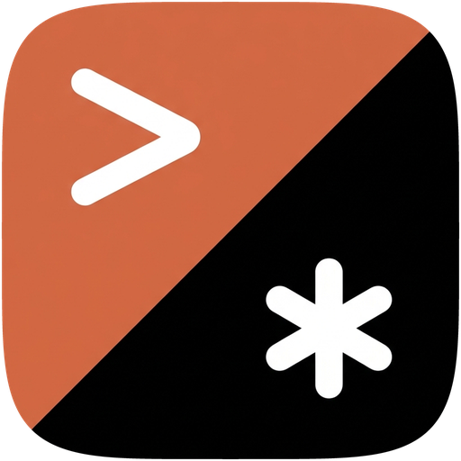
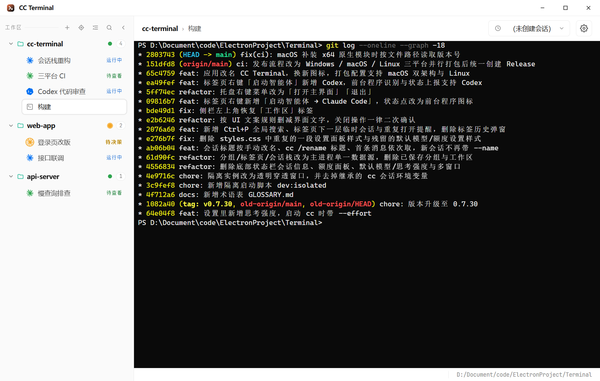
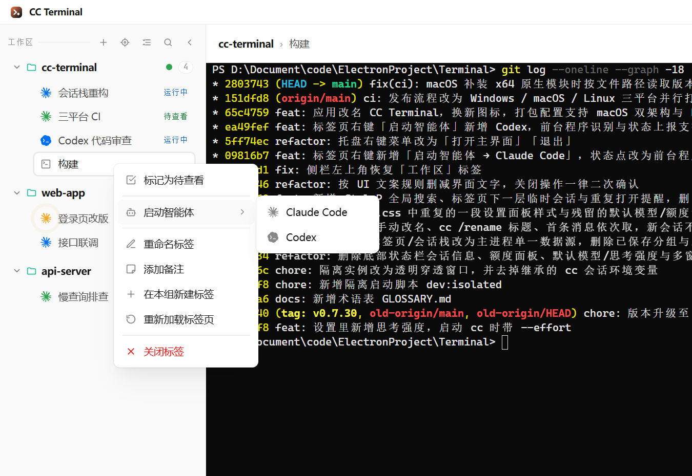
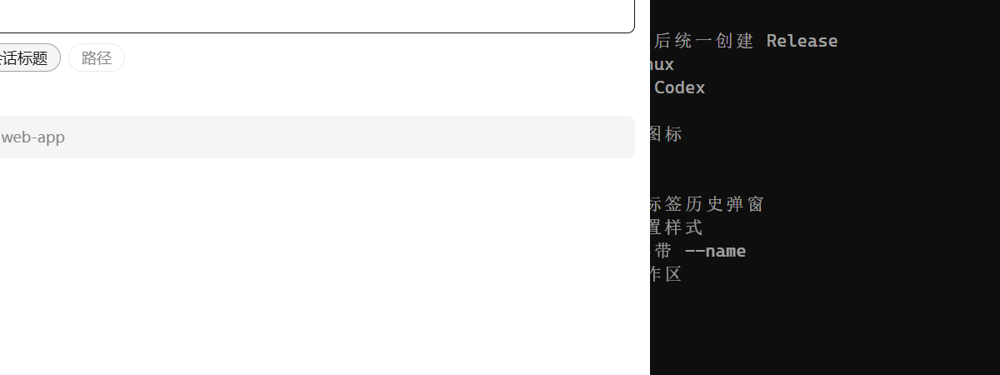

<div align="center">



# CC Terminal

**给 Claude Code 和 Codex 用的多会话终端**

<p>
  
  
  
  
</p>



</div>

## 为什么用它

同时开着十几个 Claude Code / Codex 会话时，常见的麻烦是：

- 终端一关、电脑一重启，会话要一个个找回来再 `--resume`
- 不知道哪个会话跑完了、哪个在等你批准、哪个还在干活
- 同一个项目里开过的会话越来越多，想切回某一个很费劲

CC Terminal 只解决这几件事，其余的交给你已经在用的工具：

- **只是一个终端**：不是一站式 IDE，不带编辑器、文件树、Git 面板，也不替你和模型对话。Claude Code、Codex 还是原样跑在终端里，你熟悉的命令、快捷键、斜杠命令都不变
- **功能少，但每个都对着痛点**：自动续上会话、一眼看清每个会话的状态、一次搜索找到任何会话——没有为了「功能全」而加的东西
- **易上手，配置少**：建个分组、开个标签页就能用，右键就能启动智能体；设置项不多，默认值开箱即用
- **不绑架你的环境**：不改全局 shell 配置，不往 Claude Code 的 `settings.json` 里写 hooks，Codex 的 hooks 也只放在一份单独的配置里

## 功能

**标签页与会话**
- **按目录分组**：每个分组对应一个工作目录，组内标签页都在这个目录里打开；分组和标签页都能拖动排序
- **自动续上**：重新打开应用或标签页时，自动用 `--resume`（Codex 为 `codex resume`）接上原来的主会话
- **会话栈**：一个标签页里用过的会话都记着，标题栏下拉一键切换；也可以在标签页下一层临时打开某个旧会话，不影响当前会话
- **重复打开提醒**：同一个会话已经在别的标签页里运行时，直接切过去，避免两处同时写同一份对话记录
- **备注**：给标签页记一句话，悬停即可查看

**智能体**
- **右键启动**：在停在提示符的终端标签上右键 →「启动智能体」→ Claude Code 或 Codex，标签页就变成会自动续上的智能体标签页
- **前台程序图标**：标签前的图标显示此刻实际在跑什么——Claude、Codex、PowerShell、cmd 或 shell，手动敲 `claude` / `codex` 也能认出来

**状态一目了然**
- 图标颜色即状态：**运行中**（蓝）、**待决策**（橙，等你批准）、**待查看**（绿，这一轮做完了）、**出错**（红）、**空闲**（灰）
- 状态来自 Claude Code / Codex 的 hooks 上报，不靠猜输出
- 分组上的圆点汇总组内最需要关注的状态；可选的**桌面悬浮窗**常驻屏幕角落，显示各状态的会话数

**搜索**
- `Ctrl+P` 全局搜索标签页标题、会话标题和路径，支持拼音首字母（`dly` 命中「登录页改版」）
- 不输入关键字时列出近 7 天关闭的标签页，点一下就重新打开，会话栈原样恢复

**Claude Code 管理**
- **版本管理**：锁定 Claude Code 版本、多版本共存切换、禁止自动升级，npm 镜像自动测速
- **多账号**：保存多个 API 地址与 Token，一键切换（Token 加密存储）
- **危险模式开关**：默认以跳过权限确认的方式启动

**其他**
- 资源管理器右键「在此处打开 CC Terminal」（Windows 安装版）
- 关闭窗口时可收进托盘，会话不中断
- 中英文界面，浅色 / 深色主题，三套终端配色，垂直或水平标签栏
- 应用内检查更新

<table>
  <tr>
    <td align="center" width="55%">
      <br/>
      <sub><b>右键启动智能体</b> — 在终端标签里直接起 Claude Code 或 Codex</sub>
    </td>
    <td align="center" width="45%">
      <br/>
      <sub><b>全局搜索</b> — 标签页、会话、路径一起搜，支持拼音</sub>
    </td>
  </tr>
</table>

## 下载

前往 [最新 Release](https://github.com/Sh-Fang/CC-Terminal/releases/latest) 下载：

| 平台 | 文件 |
|---|---|
| Windows 安装版 | `CC-Terminal-x.y.z-x64.exe`，支持应用内更新 |
| Windows 绿色版 | `CC-Terminal-x.y.z-x64.zip`，解压即用 |
| macOS（Apple 芯片） | `CC-Terminal-x.y.z-mac-arm64.dmg` |
| macOS（Intel） | `CC-Terminal-x.y.z-mac-x64.dmg` |
| Linux | `CC-Terminal-x.y.z-x86_64.AppImage` 或 `.tar.gz` |

macOS 安装包没有签名：首次打开请右键 → 打开；提示「已损坏」时执行 `xattr -cr "/Applications/CC Terminal.app"`。

## 快速开始

1. 安装 [Claude Code](https://claude.com/claude-code) 和 / 或 [Codex CLI](https://github.com/openai/codex)，确认在终端里能直接运行 `claude` / `codex`
2. Windows 建议安装 [PowerShell 7](https://github.com/PowerShell/PowerShell)（没有时退回 Windows PowerShell）；macOS / Linux 使用 `$SHELL`，zsh 与 bash 有完整支持
3. 打开 CC Terminal → 新建分组，选一个项目目录 → 新建标签页时勾选「启动 Claude Code」，或在终端标签上右键「启动智能体」

**关于配置**：CC Terminal 不改你的全局 shell 配置；Claude Code 的 hooks 通过启动参数临时注入，不写进 `settings.json`（只有切换多账号时会改写其中的 `env`）。Codex 的 hooks 写在单独的 `~/.codex/cc-terminal.config.toml`，只在 CC Terminal 启动 Codex 时用 `-p cc-terminal` 加载，不影响你在别处运行的 Codex。

## 快捷键

| 按键 | 作用 |
|---|---|
| `Ctrl+P` | 全局搜索 |
| `Ctrl+F` | 在当前终端内查找 |
| `Ctrl+Tab` / `Ctrl+Shift+Tab` | 下一个 / 上一个标签页 |
| `Ctrl+T` | 在当前分组新建标签页 |
| `Ctrl+W` | 关闭当前标签页 |
| `Ctrl+C` | 有选中文字时复制，否则中断 |
| `Ctrl+V` | 粘贴 |

## 开发与构建

```bash
npm install          # .npmrc 已配好 electron 镜像与 legacy-peer-deps
npm run dev          # 开发模式
npm run dist         # Windows：NSIS 安装包 + 便携 zip
npm run dist:mac     # macOS：dmg + zip（只能在 macOS 上执行）
npm run dist:linux   # Linux：AppImage + tar.gz
```

推送到 `main` 且 `package.json` 的版本号还没有对应 tag 时，GitHub Actions 会在三个平台上并行打包并创建 Release。

## 参与进来

欢迎 Star，欢迎提 Issue 和 PR。发现 bug、有新想法、哪里用着别扭，都可以来聊聊。

## 许可证

[GPL-3.0](LICENSE) — 可以自由使用和二次开发；分发修改版需要以同样的许可证开源。
